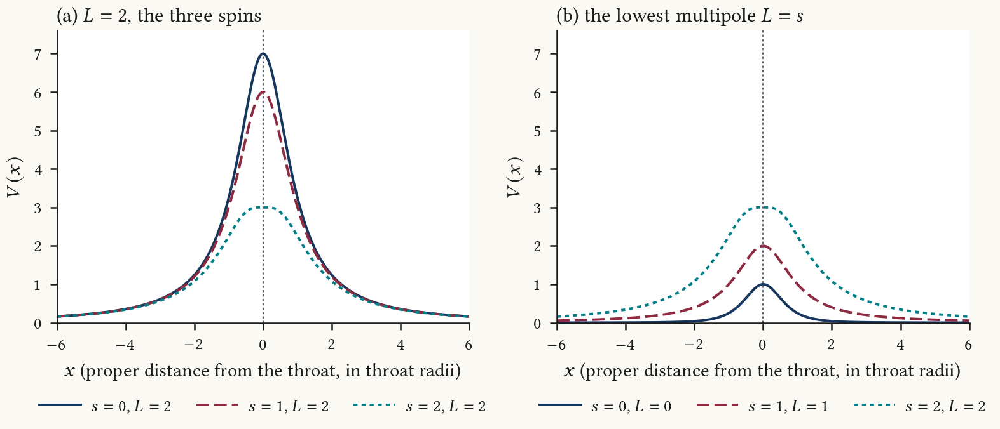

<!-- Author: Dr. Denys Dutykh (Mathematics Department, Khalifa University of Science and Technology, Abu Dhabi, UAE) -->

# morristhorne: quasinormal modes of Morris–Thorne wormholes by a Chebyshev spectral method



The effective potential V(x) = L(L + 1)/(1 + x²) + (1 − s²)/(1 + x²)² of the Morris–Thorne wormhole, as the WKB
worksheet writes it, against the proper distance x from the throat in units of the throat radius, on both sides of the
throat (the dotted line). Panel (a) compares the three spins for L = 2, panel (b) the lowest multipole of each spin.
The potential is even in x and largest at the throat, where it equals L(L + 1) + 1 − s²; for s = 2 and L = 2 its top
is flat, V = 3 − 3x⁴ + … near the throat.

morristhorne holds the Maple and MATLAB material of a study of the quasinormal modes of the Morris–Thorne wormhole
(the massless Ellis–Bronnikov wormhole), the frequencies at which massless scalar (s = 0), electromagnetic (s = 1) and
vector-type gravitational (s = 2) perturbations ring and decay. Three Maple worksheets assemble, at 200 digits, the
matrices of a Chebyshev collocation of the radial equation in three formulations: across the whole wormhole, from one
universe to the other, or from the throat to infinity with either of two boundary conditions at the throat, which
give the even and the odd overtones. Two MATLAB scripts solve the resulting quadratic eigenvalue problem, in double or
in multiple precision, a fourth worksheet gives the third-order WKB approximation for comparison, and two more carry the
derivations. The method and the results are those of the article by Davide Batic and Denys Dutykh in Classical and
Quantum Gravity (2024), cited below.

## The problem

The wormhole has no redshift function and the shape function b(r) = b0²/r, so that its line element is
ds² = −dt² + dr²/(1 − b0²/r²) + r² dΩ², with r > b0 on each side of the throat r = b0. With the time dependence
e^(−iωt) and spherical harmonics of degree ℓ ⩾ s, each perturbation obeys, in the variable z = r/b0 > 1,

```text
(√(z² − 1)/z) d/dz( (√(z² − 1)/z) dψ/dz ) + [ Ω² − V(z) ] ψ = 0,      V(z) = ℓ(ℓ + 1)/z² + ε/z⁴,

ε = 1 − s²,      Ω = ω b0,
```

and Im Ω < 0 for a damped mode. In the proper distance x from the throat, z² = 1 + x², the equation becomes
d²ψ/dx² + [Ω² − V(x)] ψ = 0 on the whole line, with V(x) = ℓ(ℓ + 1)/(1 + x²) + ε/(1 + x²)², and the quasinormal modes
are the solutions outgoing at both ends, x → ±∞. Since V is even, they are even or odd in x. The worksheets set up
three equivalent problems:

| Worksheet | Domain and condition at the throat | Overtones |
|---|---|---|
| `QNMsMorrisThorneWH-1.mw` | the whole wormhole, both universes mapped onto −1 ⩽ y ⩽ 1 by x = tan(πy/2) | all |
| `QNMsMorrisThorneWH-2.mw` | from the throat to infinity, the field finite at the throat | even |
| `QNMsMorrisThorneWH-3.mw` | from the throat to infinity, the field vanishing at the throat like √(1 − 1/z) | odd |

The last two are the boundary conditions of sections 3.1 and 3.2 of the article. In each formulation the behaviour at
the ends is built into a factorisation of the solution, whose regular part is expanded in n Chebyshev polynomials and
collocated at the n roots y_i = cos((2i − 1)π/(2n)) (a commented line switches to the Chebyshev extrema). The frequency
enters at most quadratically, which gives

```text
( M0 + i Ω M1 + Ω² M2 ) a = 0
```

with three real n × n matrices; the worksheets export `M1` without the factor i, which the MATLAB scripts apply when
they solve the problem as `polyeig(M0, 1i*M1, M2)`.

## Quick start

In Maple, open one of the worksheets `QNMsMorrisThorneWH-1.mw`, `-2.mw` or `-3.mw`, set at its top the multipole `L`
and the spin `s` (with `e := 1 - s^2`), and, under the numerical parameters, the number of Chebyshev modes `n` (200 as
distributed); the working precision is `Digits := 200`. Executing the whole worksheet assembles the matrices and ends
with three calls of `ExportMatrix`, which write `../data/M0_200.mat`, `../data/M1_200.mat` and `../data/M2_200.mat` in
the ASCII format of MATLAB, relative to the current folder of Maple (`currentdir()`); the folder must exist, and the
names keep `200` whatever `n` is.

The two MATLAB scripts read these files from other places: `findeigsdp.m` reads `data/M0_200.mat` and the others from
the current folder of MATLAB, `findeigshp.m` reads `M0_200.mat` and the others from the current folder itself. The
simplest is to edit the three export paths at the end of the worksheet so that they name the folder `data/` of the
repository, create it, and then, in MATLAB, from the folder of the repository:

```matlab
findeigsdp
```

This script solves the problem in double precision, from matrices read with `readmatrix`, and draws the spectrum in the
window −6 ⩽ Re Ω ⩽ 6, −5 ⩽ Im Ω ⩽ 1. Its multiprecision counterpart `findeigshp.m` needs the Advanpix Multiprecision
Computing Toolbox, whose folder is set by the line `addpath('../advanpix/')`, works with `mp.Digits(200)` and reads the
matrices with `mp.read`; it is run from the folder that holds them. The quasinormal frequencies are the eigenvalues that
stay in place when n changes: the article overlaps n = 150, 200 and 300, computes with 200 digits, and found the
spectra of double precision distorted and inaccurate beyond the first few modes.

The worksheet `QNM-WKB3.mw` gives the third-order WKB estimate of a frequency: with `L`, `s` and the overtone number `n`
set at its top, it locates the peak x0 of V(x), evaluates the derivatives of V up to the sixth order there, and returns

```text
Ω = √( V0 − i √(−2V0″) (n + 1/2 + Λ2 + Λ3) ),
```

where V0 and V0″ are the values of V and of its second derivative at the peak and Λ2, Λ3 the corrections of second and
third order. The formula divides by V0″, which vanishes for s = 2 and L = 2 (the flat top of the figure), and the article
gives no WKB value in that case.

## Contents

| File | Content |
|---|---|
| `MORRIS_THORNE_WORMH_SUPPLEMENTAL_MATERIAL.mw` | Maple worksheet: the radial equation and its potential, the change of variables that encodes the quasinormal boundary conditions in both universes, the orders of the zeros of the coefficients, and the limits and tabulated values quoted in the article |
| `FROM_THROAT-MORRIS-THORNE_WORMHOLE_SUPPL_MATERIAL.mw` | the same for the formulations from the throat to infinity |
| `QNMsMorrisThorneWH-1.mw`, `-2.mw`, `-3.mw` | the three assembly worksheets described above |
| `QNM-WKB3.mw` | the third-order WKB approximation |
| `findeigsdp.m`, `findeigshp.m` | the MATLAB scripts, in double and in multiple precision |
| `docs/figures/` | the script `plot_readme_figure.py` that draws the figure of this page from the potential, with the style file beside it |

## Requirements

Maple 2022 or later, in which the worksheets are saved (releases 2022.1 and 2022.2); they use `LinearAlgebra` and
`PDEtools`. MATLAB R2019a or later for `readmatrix` and `polyeig`, and the Advanpix Multiprecision Computing Toolbox (a
commercial toolbox) for `findeigshp.m`, which gives the digits reported in the article. The figure of this page needs
Python 3 with NumPy and Matplotlib, and is redrawn from `docs/figures/` by `python3 plot_readme_figure.py`.

## How to cite

If you use this code, please cite the article:

D. Batic and D. Dutykh, A unified spectral approach for quasinormal modes of Morris–Thorne wormholes, Classical and
Quantum Gravity 41, 215003 (2024).

https://doi.org/10.1088/1361-6382/ad7cb8

```bibtex
@article{Batic2024,
  author = {Batic, Davide and Dutykh, Denys},
  title = {A Unified Spectral Approach for Quasinormal Modes of {{Morris-Thorne}} Wormholes},
  journal = {Classical and Quantum Gravity},
  year = 2024,
  month = nov,
  volume = {41},
  number = {21},
  pages = {215003},
  doi = {10.1088/1361-6382/ad7cb8},
  eprint = {2410.05979},
  archiveprefix = {arXiv}
}
```

The button "Cite this repository" in the right-hand column of this page gives the same reference, read from
`CITATION.cff`. A free copy of the article is on arXiv:

https://arxiv.org/abs/2410.05979

## Licence

GNU Lesser General Public License, version 2.1 (see `LICENSE`).

## Authors

Davide Batic and Denys Dutykh (Mathematics Department, Khalifa University of Science and Technology, Abu Dhabi). The
article is listed, with the other studies of quasinormal modes of the same group, in the
[Quasi-Normal Modes Hall of Fame](https://qnms.denys-dutykh.com/).

https://www.denys-dutykh.com/
